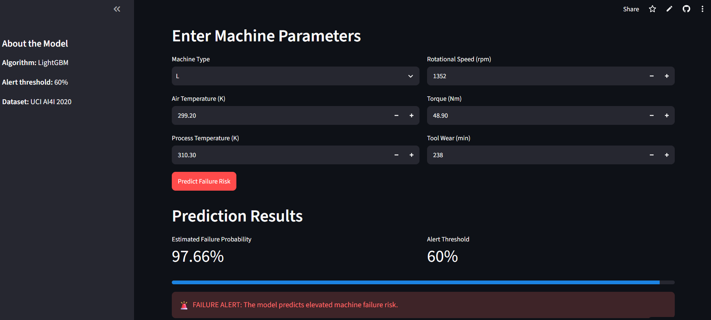

# Predictive Maintenance Intelligence
### Machine Failure Prediction Using LightGBM and Explainable AI

An end-to-end machine learning project that predicts machine failure risk from operating parameters and provides interactive predictions through a Streamlit web application.

## 🚀 Live Application

**Try the application:** [Predictive Maintenance Intelligence](https://predictive-maintenance-intelligence-3gooc8zakagmqnhsee9g7g.streamlit.app/)

> Note: This project uses the synthetic UCI AI4I 2020 Predictive Maintenance dataset. Predictions require validation before any real industrial application.

## 🖥️ Application Preview



The application accepts machine operating parameters and displays
an estimated failure probability with an alert based on the
selected classification threshold.

## 🧪 Application Testing

The deployed Streamlit application was tested using three
different machine operating configurations.

| Test | Machine Type | Rotational Speed (rpm) | Torque (Nm) | Tool Wear (min) | Predicted Failure Probability | Result |
|---|---|---:|---:|---:|---:|---|
| Low-risk input | H | 1800 | 20 | 10 | 0.00% | Normal Status |
| High-risk input | L | 1200 | 60 | 250 | 98.65% | Failure Alert |
| Alternative input | M | 1500 | 40 | 100 | 0.03% | Normal Status |

The application correctly applied the configured 60% alert
threshold to these test cases.

**Note:** These are functional application tests using a model
trained on synthetic data. They do not establish real-world
industrial reliability.
## 📌 Project Overview

Unexpected machine failures can cause production interruptions, maintenance expenses, and equipment downtime.

This project develops a machine learning-based predictive maintenance system that estimates machine failure probability using operating conditions such as temperature, rotational speed, torque, and tool wear.

The trained model is integrated into an interactive Streamlit application that allows users to enter machine parameters and receive a failure-risk estimate.

## 🎯 Objectives

- Develop a machine failure classification pipeline.
- Compare multiple machine learning algorithms.
- Address class imbalance in the dataset.
- Tune model hyperparameters using cross-validation.
- Select a classification threshold using validation data.
- Evaluate performance on a held-out test set.
- Investigate model behavior using feature importance and SHAP.
- Deploy an interactive prediction application.

## 📊 Dataset

**Dataset:** AI4I 2020 Predictive Maintenance Dataset  
**Source:** [UCI Machine Learning Repository](https://archive.ics.uci.edu/dataset/601/ai4i+2020+predictive+maintenance+dataset)

The dataset contains 10,000 observations representing synthetic industrial machine operating conditions.

The target variable is `Machine failure`:

- `0` — No machine failure
- `1` — Machine failure

### Input Features

| Feature | Description |
|---|---|
| Type | Machine quality/product type |
| Air temperature [K] | Air temperature in Kelvin |
| Process temperature [K] | Process temperature in Kelvin |
| Rotational speed [rpm] | Rotational speed |
| Torque [Nm] | Operating torque |
| Tool wear [min] | Accumulated tool wear |

Identifier columns and failure-mode indicators were excluded from the model inputs to avoid target leakage.

### Class Imbalance

The dataset contains 9,661 non-failure observations and 339 failure observations.

Because failure cases are relatively rare, accuracy alone is insufficient for model selection. Precision, recall, F1-score, Average Precision, and confusion matrices were also considered.

## 🛠️ Methodology

The project follows an end-to-end machine learning workflow:

1. Dataset loading and exploratory analysis.
2. Feature selection and leakage prevention.
3. Stratified train-validation-test splitting.
4. Numerical feature scaling and categorical encoding.
5. Model training and comparison.
6. Hyperparameter tuning.
7. Classification-threshold selection.
8. Final test evaluation.
9. Feature importance and SHAP analysis.
10. Model serialization and Streamlit deployment.

### Data Splitting

The dataset was divided into:

| Split | Samples | Purpose |
|---|---:|---|
| Training | 7,000 | Model fitting |
| Validation | 1,500 | Model selection and threshold tuning |
| Final test | 1,500 | Final evaluation |

The split was stratified to preserve the failure-class proportion.

### Models Evaluated

- Logistic Regression
- Decision Tree
- Random Forest
- XGBoost
- CatBoost
- LightGBM

Randomized hyperparameter search with stratified cross-validation was used to tune the Random Forest model. LightGBM was selected for the deployed application based on validation performance and the selected precision-recall trade-off.

## 📈 Final Model Performance

The deployed LightGBM model was evaluated on the held-out test set using a classification threshold of `0.60`.

| Metric | Test Result |
|---|---:|
| Accuracy | 98.73% |
| Precision | 79.63% |
| Recall | 84.31% |
| F1-score | 81.90% |
| Average Precision | 89.85% |
| ROC-AUC | 98.50% |

### Confusion Matrix

| | Predicted: No Failure | Predicted: Failure |
|---|---:|---:|
| Actual: No Failure | 1,438 | 11 |
| Actual: Failure | 8 | 43 |

The model identified 43 of the 51 failure cases in the held-out test set.

**Important:** These results apply to the specified synthetic dataset and evaluation split. They do not establish performance on real industrial machines.

## 🔎 Explainability

Feature importance and SHAP were used to investigate the model's predictions.

Features identified as important included:

- Tool wear
- Torque
- Rotational speed
- Air temperature
- Process temperature

These explanations describe how the trained model uses the input features. They do not demonstrate that a feature directly causes machine failure.

## 💻 Technology Stack

- Python
- Pandas
- NumPy
- Scikit-learn
- LightGBM
- XGBoost
- CatBoost
- SHAP
- Matplotlib
- Seaborn
- Streamlit
- Joblib
- Google Colab

## 🖥️ Run Locally

### 1. Clone the repository

```bash
git clone https://github.com/souroviakter689/predictive-maintenance-intelligence.git
cd predictive-maintenance-intelligence
```

### 2. Create a virtual environment

```bash
python -m venv .venv
```

Activate it:

**Windows**

```bash
.venv\Scripts\activate
```

**macOS/Linux**

```bash
source .venv/bin/activate
```

### 3. Install dependencies

```bash
pip install -r requirements.txt
```

### 4. Run the application

```bash
streamlit run app.py
```

The application will provide a local URL in the terminal.

## 📁 Repository Structure

```text
predictive-maintenance-intelligence/
├── app.py
├── predictive_maintenance_model.joblib
├── requirements.txt
├── runtime.txt
├── pyproject.toml
└── README.md
```

The notebook used for model development and evaluation can also be included in the repository.

## ⚠️ Limitations

- The AI4I 2020 dataset is synthetic.
- Real-world industrial generalization has not been established.
- The final test set contains 51 failure cases, so performance estimates have uncertainty.
- SHAP explanations describe model behavior rather than causal relationships.
- The selected threshold reflects a particular precision-recall trade-off.
- Real-world deployment requires external validation, probability calibration, and operational risk assessment.

## 🔮 Future Improvements

- Validate the system using real industrial sensor data.
- Investigate time-series features and early-warning prediction.
- Evaluate probability calibration and alternative alert thresholds.
- Add prediction history and monitoring dashboards.
- Monitor data drift and model performance after deployment.
- Improve deployment reliability and automated testing.

## 👤 Author

**Sourovi Akter**

GitHub: [souroviakter689](https://github.com/souroviakter689)

---

*This project was developed for machine learning practice and portfolio demonstration. It is not a certified industrial safety or diagnostic system.*
